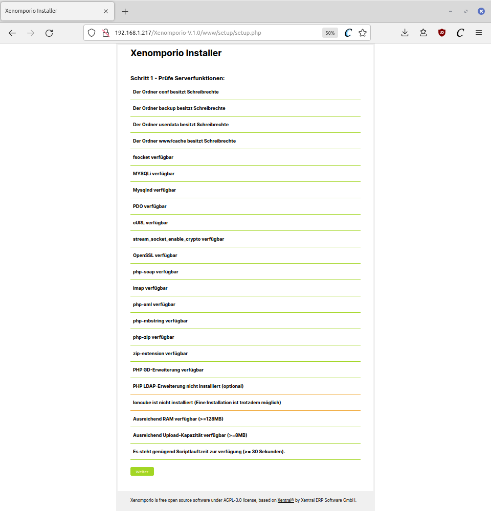
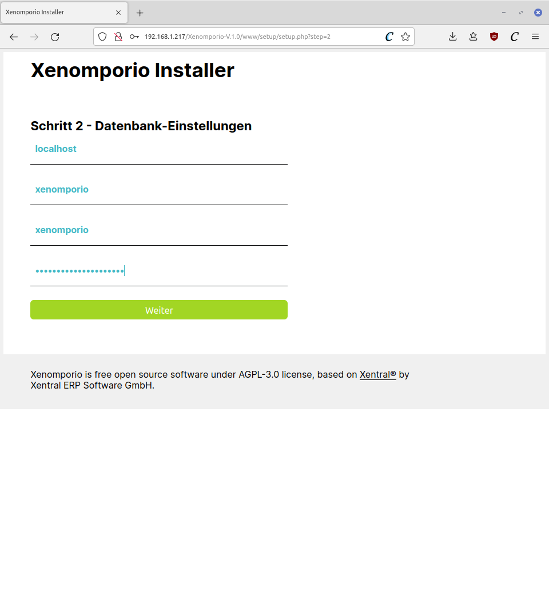
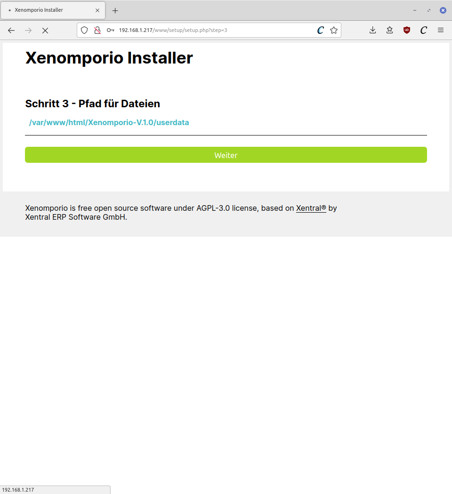
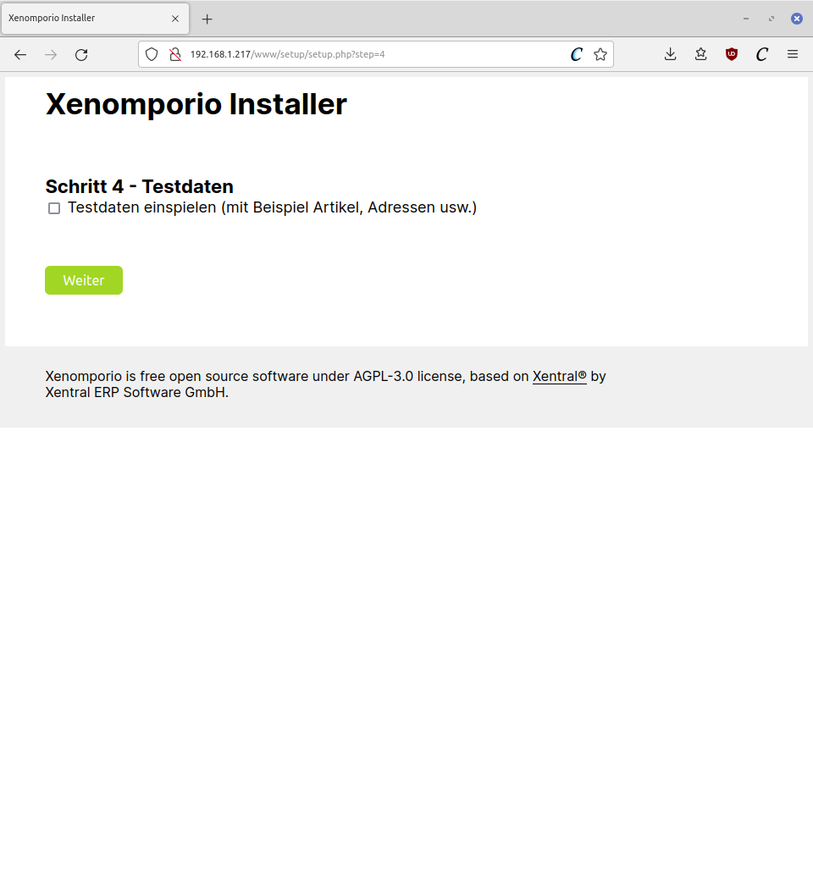
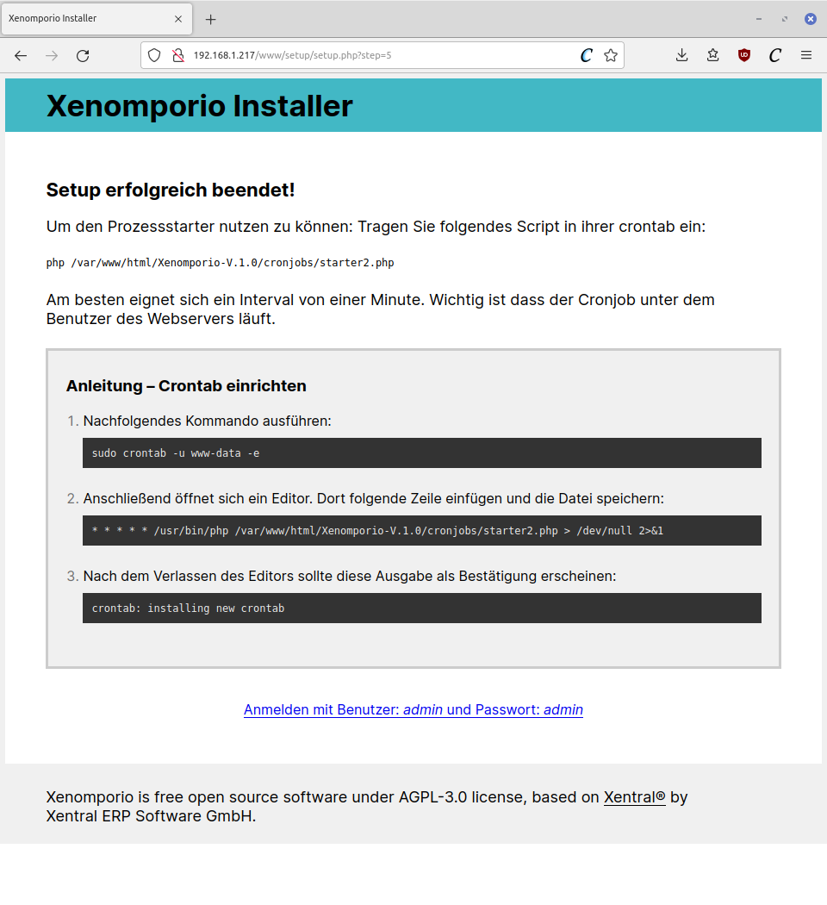
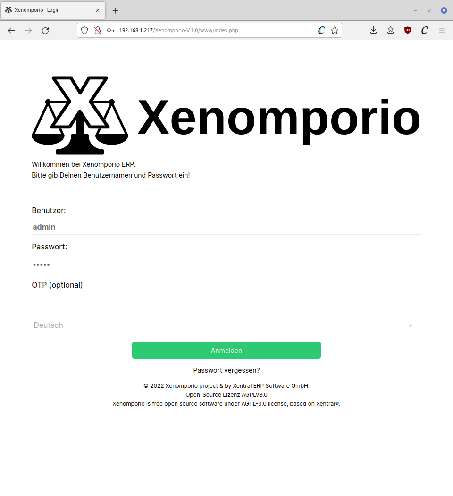
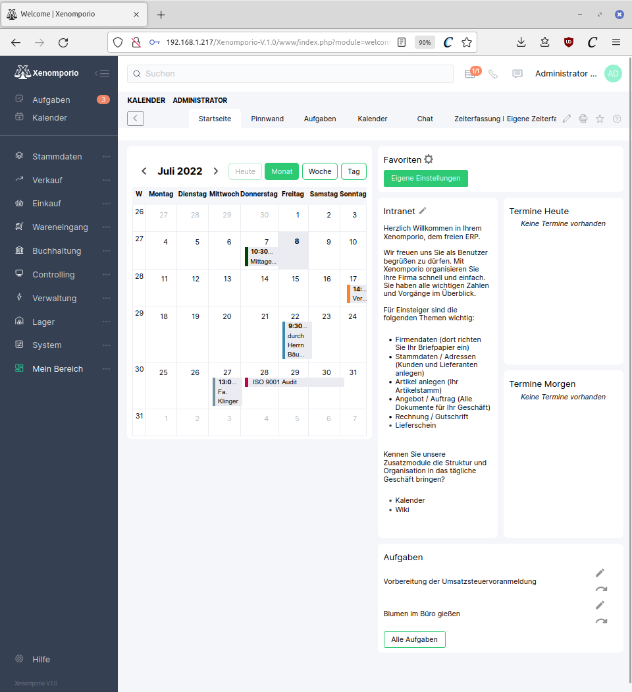

# OpenXE Application Installation

This guide covers deploying the OpenXE files onto a prepared Linux web server and completing the web-based setup wizard.

> [!NOTE]
> Ensure that your server meets all prerequisites before proceeding. See [SERVER_INSTALL.md](SERVER_INSTALL.md) for full server preparation:
> - **Supported OS & PHP:** **Ubuntu 24.04 LTS** (ships with **PHP 8.3**) or **Ubuntu 26.04 LTS** (ships with **PHP 8.5**).
> - **Security:** PHP 8.1 is officially **End-of-Life (EOL)** and must no longer be used.
> - **Web Server:** Apache 2 with `mod_rewrite`, `headers`, and `AllowOverride All`.
> - **Database:** MariaDB 10.11+ / 11.x with an initialized `openxe` database.

---

## 1. Deploy the Application Files

Navigate to your web directory (e.g. `/var/www/html`):

```bash
cd /var/www/html
```

### Option A: Using Git (Recommended)

Clone the desired release branch directly from GitHub:

```bash
sudo git clone -b 1.13 https://github.com/OpenXE-org/OpenXE.git openxe
```

### Option B: Using a Release ZIP Archive

Download and extract the release archive into `/var/www/html/openxe`:

```bash
sudo wget https://github.com/OpenXE-org/OpenXE/archive/refs/heads/1.13.zip -O openxe-1.13.zip
sudo unzip openxe-1.13.zip
sudo mv OpenXE-1.13 openxe
sudo rm openxe-1.13.zip
```

---

## 2. Set File Permissions

Grant ownership of the application directory to the web server user (`www-data`):

```bash
sudo chown -R www-data:www-data /var/www/html/openxe
sudo chmod -R 755 /var/www/html/openxe
```

---

## 3. Launch the Web-Based Setup Wizard

Open your browser and navigate to:

```text
http://<YOUR_SERVER_IP>/openxe
```
*(Note: Linux paths and URLs are case-sensitive).*

Follow the on-screen installer steps:

### Step 1: Welcome & License Agreement
Read and accept the OpenXE license terms.


### Step 2: System & Environment Verification
The installer checks system requirements, verifying a supported PHP runtime (PHP 8.3 / PHP 8.5) and the required PHP extensions (`pdo_mysql`, `curl`, `gd`, `zip`, `xml`, `mbstring`, `soap`).


### Step 3: Database Connection
Enter the database connection parameters created during server setup:
* **Host:** `localhost`
* **Database:** `openxe`
* **User:** `openxe`
* **Password:** *(the database password you assigned)*


### Step 4: Administrator Account
Create the primary administrator user account and set a strong master password.


### Step 5: Company & Base Configuration
Enter your company name, address, standard currency, default tax rates, and locale settings.


### Step 6: Database Schema & Migration Execution
The wizard initializes all database tables, default datasets, and system configurations.


### Step 7: Installation Complete


Once the installer finishes, log in to OpenXE using your administrator credentials.
